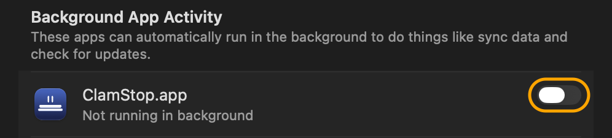

# ClamStop

macOS menu bar app that puts a MacBook to sleep when its lid closes, even in clamshell mode,
then hibernates it after a configurable delay.

<!-- Keep the next three paragraphs identical to the in-app help (LidHelpView in
     Sources/ClamStop/SettingsView.swift). -->
When a MacBook is connected to an external display, macOS keeps it awake after the lid closes
(clamshell mode). Since macOS 26 Tahoe, there is no longer a setting to turn this off.

With ClamStop, closing the lid always puts the Mac to sleep, as it does when nothing is
connected. Open the lid or press a key to wake it.

After the chosen delay, the Mac hibernates: the content of its memory is saved to disk and it
stops drawing power, which spares the battery. Waking up then takes a few seconds longer.

Work in progress. Requires macOS 14 Sonoma or later (Apple silicon or Intel).

## Install

1. Download `ClamStop-<version>.dmg` from the
   [latest release](https://github.com/ChanOJ/ClamStop/releases/latest). Pre-releases are
   listed on the [releases page](https://github.com/ChanOJ/ClamStop/releases).
2. Optional: download the `.sha256` file next to it and check the download:

   ```bash
   cd ~/Downloads && shasum -a 256 -c ClamStop-*.dmg.sha256
   ```

3. Open the DMG and drag **ClamStop** onto **Applications**. Eject the DMG.
4. Open ClamStop from the Applications folder. If macOS blocks it, see
   [Opening an unsigned build](#opening-an-unsigned-build).
5. [Allow the background service](#allow-the-background-service).

### Opening an unsigned build

Release notes say whether a build is notarized. Builds that are not (every build until the
project has an Apple Developer account) are blocked by Gatekeeper at first launch. Only bypass
this for a DMG downloaded from this repository, or for a build of your own.

On macOS 15 Sequoia or later:

1. Open ClamStop once. In the warning, click **Done** (not "Move to Trash").
2. Open **System Settings > Privacy & Security** and scroll down to **Security**.
3. Next to the message about ClamStop, click **Open Anyway**, then authenticate.
4. Confirm with **Open Anyway** in the last dialog.

On macOS 14 Sonoma, Control-click the app in Finder, choose **Open**, then **Open** again.

Alternative, in Terminal: remove the quarantine attribute, then open the app as usual.

```bash
xattr -dr com.apple.quarantine /Applications/ClamStop.app
```

### Allow the background service

Putting the Mac into hibernation needs administrator rights, so ClamStop installs a small
background service, which macOS asks you to approve.

1. At first launch, ClamStop registers the service. The settings window shows
   "Waiting for approval in System Settings".
2. Click **Open Login Items Settings…**, or open **System Settings > General > Login Items &
   Extensions** (**Login Items** on macOS 14).
3. Under **Background App Activity** (**Allow in the Background** on older macOS versions),
   turn the **ClamStop** switch on, so that it turns blue, and authenticate as an administrator:

   

4. macOS may quit ClamStop at that moment: open it again from the Applications folder.
   The status then shows "On" within a few seconds.

After updating an unsigned build, if the service stays "not responding", turn ClamStop off and
on again in the same list.

## Uninstall

1. Open the ClamStop settings (menu bar icon > **Settings…**, or open the app again from the
   Applications folder).
2. Click **Uninstall ClamStop…**, then **Uninstall**. ClamStop restores the default sleep
   settings, deletes the files of its background service, removes that service and the login
   item, then quits.
3. Move ClamStop from the Applications folder to the Trash.
4. Optional: delete the app preferences that remain. An error saying the domain does not exist
   means there is nothing left.

   ```bash
   defaults delete io.github.chanoj.clamstop
   ```

If the background service was not responding during step 2, run this before step 3. It sets the
default hibernation mode again, cancels the wakes scheduled by ClamStop and deletes the files of
the service (the command also helps whenever the sleep settings look wrong):

```bash
sudo /Applications/ClamStop.app/Contents/MacOS/ClamStopDaemon --restore-defaults
```

### If the app was deleted first

1. Stop the background service. An error saying it cannot be found means it is already gone.

   ```bash
   sudo launchctl bootout system/io.github.chanoj.clamstop.daemon
   ```

2. Restore the default hibernation mode of a MacBook:

   ```bash
   sudo pmset -a hibernatemode 3
   ```

3. Delete the files of the background service:

   ```bash
   sudo rm -rf "/Library/Application Support/ClamStop"
   ```

4. Check that no wake scheduled by ClamStop remains in the list (a leftover one only wakes the
   Mac once):

   ```bash
   pmset -g sched
   ```

5. If ClamStop is still listed in **Login Items & Extensions**, turn it off there.

## Build from source

Requirements: macOS 14 or later, with Xcode 16 or later, or with the Command Line Tools alone
if they ship Swift 6.4 or later (earlier ones cannot build the universal app):

```bash
xcode-select --install
```

Build the universal app into `dist/ClamStop.app`, signed ad-hoc:

```bash
scripts/build-app.sh
```

Check the bundle:

```bash
scripts/verify-app.sh
```

Package it into a DMG in `dist/`:

```bash
scripts/make-dmg.sh
```

Run the tests:

```bash
swift test
```

The version comes from the latest `v*` tag; set `VERSION=1.2.3` to choose another one. The app
icon is a placeholder, drawn by `swift scripts/make-icon.swift`; replace
`Resources/AppIcon.icns` to change it.

## Releases

Pushing a `v*` tag builds the DMG and publishes a GitHub Release with its SHA-256 checksum.
Once the Apple credentials are configured, the same workflow signs and notarizes it: see
[docs/signing.md](docs/signing.md).

## License

MIT, see [LICENSE](LICENSE).
