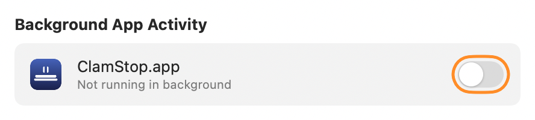

# ClamStop

macOS menu bar app that puts a MacBook to sleep when its lid closes, even in clamshell mode,
then hibernates it after a configurable delay.

<!-- Keep the next three paragraphs identical to the in-app help (LidHelpView in
     Sources/ClamStop/SettingsView.swift). -->
When a MacBook is connected to an external display, macOS keeps it awake after the lid closes
(clamshell mode). Since macOS 26 Tahoe, there is no longer a setting to turn this off.

With ClamStop, closing the lid always puts the Mac to sleep, as it does when nothing is
connected. Open the lid or press a key to wake it.

After the chosen delay, the Mac hibernates: the content of its memory is saved to disk and it
stops drawing power, which spares the battery. Waking up then takes a few seconds longer.

Work in progress. Requires macOS 14 Sonoma or later (Apple silicon or Intel).

## Settings

Everything is free. The settings window has eight tabs:

- **General**: what happens when you close the lid (sleep, or do what macOS does), the
  hibernation delay (immediately, after 5 minutes to 4 hours, or never), the menu bar icon,
  opening at login, and the background service.
- **Stay Awake**: stay awake with the lid closed while AI agents work. See [AI agents](#ai-agents).
- **Rules**: different settings on battery (sleep or not, and another hibernation delay).
- **Safety**: guards that end staying awake with the lid closed: battery below a level (20 % by
  default), heat, power adapter unplugged (on by default), longest time (no limit by default).
- **Actions**: hibernate at once when the lid closes on battery below a level.
- **Automation**: install or remove the AI agent hooks.
- **Journal**: when the Mac slept, for how long, whether it hibernated and how much battery it
  used. Kept for 30 days, on this Mac only.
- **About**: version, links and credits.

The menu bar menu has **Stay Awake**: keep the Mac awake until you turn it off, for 5 minutes to
8 hours, or until a time of day. It does not sleep when idle, and with the lid closed it stays
awake within the Safety guards (on power adapter only by default); any sleep ends it, and so
does quitting ClamStop (it asks first).
ClamStop sends a notification when a Stay Awake session ends on its own, when a Safety guard
puts the Mac to sleep (shown when it wakes), and when the background service needs your
approval; turn them off in System Settings > Notifications. The menu
also has **Sleep Now** and **Hibernate Now**. While the Mac sleeps with
hibernation planned, ClamStop pauses audio and video and resumes them on wake, so the short
wake before hibernation stays silent.

### AI agents

When you install the hooks (Automation tab, or the first-run assistant), ClamStop adds a hook to the agents' settings
(`~/.claude/settings.json` for Claude Code, including the Code sessions of the Claude desktop
app, and `~/.codex/hooks.json` for Codex). Your other hooks are kept, and a backup of each file
is written next to it (`.clamstop-backup`). Remove Hooks, or uninstalling ClamStop, removes the
hook.

The agent runs the hook when a task starts and ends; the hook passes the event to ClamStop's
background service. While a task runs, the service sets `pmset disablesleep 1`, the only setting
that also stops the lid-close sleep of a Mac without external display, and sets it back to `0` as
soon as no task runs. To avoid keeping the Mac awake for nothing, the service also checks, every
15 seconds and only while a task runs, that the agent process still exists and is still busy
(its transcript is written, or it or its child processes use the CPU, for example during a long
build). A task counts as finished 90 seconds after the agent's turn ends, or after 30 minutes
without any sign of work.

The guards of the Safety tab apply: by default the Mac only stays awake for agents on power
adapter, and sleeps when it gets hot. On battery (guard turned off), it sleeps below 20 %.

Codex support follows the hook format Codex documents; it has not been tested with Codex yet.

## Install

1. Download `ClamStop-<version>.dmg` from the
   [latest release](https://github.com/ChanOJ/ClamStop/releases/latest). Pre-releases are
   listed on the [releases page](https://github.com/ChanOJ/ClamStop/releases).
2. Optional: download the `.sha256` file next to it and check the download:

   ```bash
   cd ~/Downloads && shasum -a 256 -c ClamStop-*.dmg.sha256
   ```

3. Open the DMG and drag **ClamStop** onto **Applications**. Eject the DMG.
4. Open ClamStop from the Applications folder. If macOS blocks it, see
   [Opening an unsigned build](#opening-an-unsigned-build).
5. [Allow the background service](#allow-the-background-service).

### Opening an unsigned build

Release notes say whether a build is notarized. Builds that are not (every build until the
project has an Apple Developer account) are blocked by Gatekeeper at first launch. Only bypass
this for a DMG downloaded from this repository, or for a build of your own.

On macOS 15 Sequoia or later:

1. Open ClamStop once. In the warning, click **Done** (not "Move to Trash").
2. Open **System Settings > Privacy & Security** and scroll down to **Security**.
3. Next to the message about ClamStop, click **Open Anyway**, then authenticate.
4. Confirm with **Open Anyway** in the last dialog.

On macOS 14 Sonoma, Control-click the app in Finder, choose **Open**, then **Open** again.

Alternative, in Terminal: remove the quarantine attribute, then open the app as usual.

```bash
xattr -dr com.apple.quarantine /Applications/ClamStop.app
```

### Allow the background service

Putting the Mac into hibernation needs administrator rights, so ClamStop installs a small
background service, which macOS asks you to approve.

1. At first launch, ClamStop registers the service. The settings window shows
   "Waiting for approval in System Settings".
2. Click **Open Login Items Settings…**, or open **System Settings > General > Login Items &
   Extensions** (**Login Items** on macOS 14).
3. Under **Background App Activity** (**Allow in the Background** on older macOS versions),
   turn the **ClamStop** switch on, so that it turns blue, and authenticate as an administrator:

   <picture>
     <source media="(prefers-color-scheme: dark)" srcset="docs/images/allow-background-service-dark.png">
     
   </picture>

4. macOS may quit ClamStop at that moment: open it again from the Applications folder.
   The status then shows "On" within a few seconds.

### Updating an unsigned build

At registration, macOS records the exact code signature of the background service. Every
unsigned (ad-hoc) build has a different one, so after replacing ClamStop.app macOS refuses to
start the new service, and turning the switch off and on again does not help. Register the
service again instead:

1. Quit ClamStop (menu bar icon > **Quit ClamStop**) and quit System Settings.
2. Replace `/Applications/ClamStop.app` with the new version.
3. Open ClamStop and register the service again: in **General**, click **Reinstall Background
   Service**, or start it from Terminal with:

   ```bash
   open /Applications/ClamStop.app --args --reinstall-service
   ```

   The old registration is removed and the ClamStop switch in System Settings is now off.
4. Open **System Settings > General > Login Items & Extensions** and turn the **ClamStop** switch
   on **once**. Do not turn it off and on again: that brings the old registration back.
   If the switch already looks on, System Settings shows an old state: quit it and open it again.
5. If ClamStop does not quit and still shows "Waiting for approval" after 15 seconds, quit it and
   open it again.
6. **General** shows "Background service running".

To check the service from Terminal (`state = running`; `last exit code = 78: EX_CONFIG` means
macOS refused the new build, start again at step 1):

```bash
launchctl print system/io.github.chanoj.clamstop.daemon | grep -E "state|last exit"
```

Builds signed with a Developer ID (releases once the project has an Apple Developer account)
keep the same signature from one version to the next and do not need any of this.

## Uninstall

1. Open the ClamStop settings (menu bar icon > **Settings…**, or open the app again from the
   Applications folder).
2. Click **Uninstall ClamStop…**, then **Uninstall**. ClamStop restores the default sleep
   settings, deletes the files of its background service, removes that service and the login
   item, then quits.
3. Move ClamStop from the Applications folder to the Trash.
4. Optional: delete the app preferences that remain. An error saying the domain does not exist
   means there is nothing left.

   ```bash
   defaults delete io.github.chanoj.clamstop
   ```

If the background service was not responding during step 2, run this before step 3. It sets the
default hibernation mode again, cancels the wakes scheduled by ClamStop and deletes the files of
the service (the command also helps whenever the sleep settings look wrong):

```bash
sudo /Applications/ClamStop.app/Contents/MacOS/ClamStopDaemon --restore-defaults
```

### If the app was deleted first

1. Stop the background service. An error saying it cannot be found means it is already gone.

   ```bash
   sudo launchctl bootout system/io.github.chanoj.clamstop.daemon
   ```

2. Restore the default hibernation mode of a MacBook:

   ```bash
   sudo pmset -a hibernatemode 3
   ```

3. If AI agents were kept awake, make sure sleep is not left disabled: if `pmset -g` lists
   `SleepDisabled 1`, run:

   ```bash
   sudo pmset -a disablesleep 0
   ```

   Then remove the ClamStop entries (commands containing `ClamStop` and `--agent-hook`) from the
   `hooks` of `~/.claude/settings.json` and `~/.codex/hooks.json`.

4. Delete the files of the background service:

   ```bash
   sudo rm -rf "/Library/Application Support/ClamStop"
   ```

5. Check that no wake scheduled by ClamStop remains in the list (a leftover one only wakes the
   Mac once):

   ```bash
   pmset -g sched
   ```

6. If ClamStop is still listed in **Login Items & Extensions**, turn it off there.

## Build from source

Requirements: macOS 14 or later, with Xcode 16 or later, or with the Command Line Tools alone
if they ship Swift 6.4 or later (earlier ones cannot build the universal app):

```bash
xcode-select --install
```

Build the universal app into `dist/ClamStop.app`, signed ad-hoc:

```bash
scripts/build-app.sh
```

Check the bundle:

```bash
scripts/verify-app.sh
```

Package it into a DMG in `dist/`:

```bash
scripts/make-dmg.sh
```

Run the tests (also works with only the Command Line Tools installed):

```bash
scripts/test.sh
```

The version comes from the latest `v*` tag; set `VERSION=1.2.3` to choose another one. The app
icon is drawn by `swift scripts/make-icon.swift`, which writes `Resources/AppIcon.icns`.

## Releases

Pushing a `v*` tag builds the DMG and publishes a GitHub Release with its SHA-256 checksum.
Once the Apple credentials are configured, the same workflow signs and notarizes it: see
[docs/signing.md](docs/signing.md).

Signed releases also publish the feed that installed copies check for updates (Sparkle), see
[docs/updates.md](docs/updates.md).

## License

MIT, see [LICENSE](LICENSE).

The AI agent keep-awake feature adapts ideas and rules from
[clamshut](https://github.com/IshaanChamoli/clamshut) by Ishaan Chamoli (MIT): see
[THIRD_PARTY_NOTICES.md](THIRD_PARTY_NOTICES.md).
